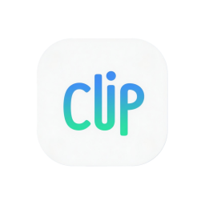
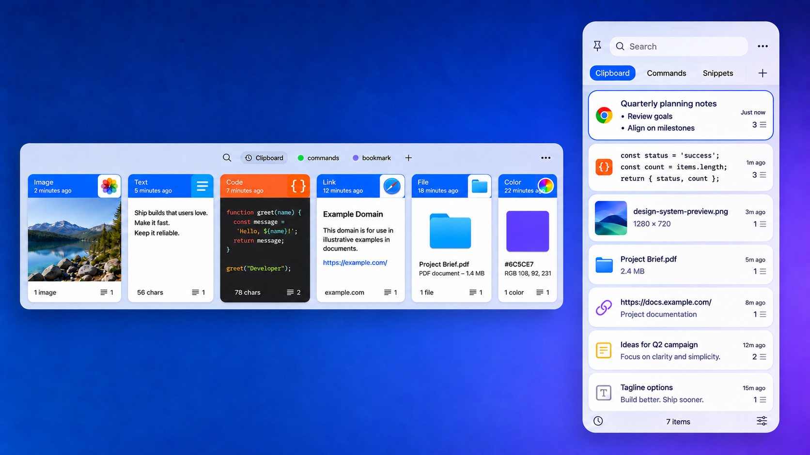

<p align="center">
    <div align="center"></div>
    <h2 align="center">Clipboard</h2>
    <div align="center">A modern, ultra-fast, battery-efficient, and end-to-end encrypted clipboard manager for macOS.</div>
    <div align="center"><strong>English</strong> | <a href="https://github.com/Ineffable919/clipboard/blob/master/README_ZH.md">中文</a></div>
</p>



## 📥 Download

Download the latest version from [Releases](https://github.com/Ineffable919/clipboard/releases/latest)

---

## ✨ Features & Architecture

### 🔐 End-to-End Encrypted Cloud Sync (E2EE WebDAV)
- **Military-Grade Security**: Encrypted using **ChaCha20-Poly1305** AEAD and **PBKDF2-HMAC-SHA256** (100,000 iterations + 32-byte CSPRNG salt). All payloads are encrypted locally before transmission; your master passphrase never leaves your device, guaranteeing zero-knowledge on the WebDAV server.
- **Git-Style 2-Character Prefix Sharding**: Adopts a 256-bucket subfolder layout (`items/00/...` ~ `items/ff/...`) modeled after Git loose objects. Prevents HTTP 504 gateway timeouts when synchronizing tens of thousands of records, while remaining backward compatible with flat directories.
- **Incremental Diff & LWW Resolution**: High-speed diff calculation comparing local SQLite metadata against remote indexes using Last-Write-Wins (LWW) conflict arbitration and payload checksums. Results in zero network transfer when no changes exist.
- **Controlled Sliding Window Worker Pipeline**: Powered by Swift structured concurrency, a sliding window keeps $\le 3$ active tasks in flight at all times. As soon as one item finishes, the next is scheduled immediately, eliminating barrier idle bubbles and boosting throughput by 30%–70%.
- **Lazy Payload Loading & Minimal Memory Footprint**: Big binary payloads are strictly excluded during diff calculation and only fetched on demand during the actual upload phase. Memory consumption remains rock-solid at **<3MB** across 10,000+ items.
- **Batch Single-Transaction Database Ingestion**: Remote items are committed using single-transaction batches in SQLite. Thousands of records are ingested in tens of milliseconds silently in the background, without UI freezes or clipboard hijacking.
- **macOS Energy & Sleep Awareness**:
  - Dynamically extends debounce delays from 15s to **60s** when macOS Low Power Mode or thermal throttling is active, cutting RF transmission and CPU wakeups.
  - Automatically cancels active network tasks before sleep to prevent socket hangs, and gracefully recovers after wake.
- **Tombstone Propagation & 30-Day Auto-Pruning**: Synchronizes deletions across devices via tombstones. Old tombstones exceeding 30 days are automatically pruned to keep the cloud index file lean.
- **Instant Cloud Asset Dashboard**: Generates comprehensive summaries of remote items, breakdown by category chips, and media type statistics without downloading raw blobs.

### ⚡️ Sub-millisecond Performance & Low Footprint
- **Composite Covering Indexes**: Engineered with 4 composite covering indexes to completely eliminate full table scans, keeping query latencies at ~**0.2ms** across 10,000+ items.
- **Runtime LRU Highlight Cache**: Attributed strings and syntax highlighting share a global LRU cache. Code cards highlight once and maintain silky-smooth **120 FPS** inertial scrolling.
- **Zero Idle Drain**: Background idle CPU usage remains at **0.0%** with near-zero battery impact.

### 🏷️ Drag-to-Reorder Category Chips
- Custom category chips support smooth horizontal drag gestures with native haptic feedback and collision snapping animations (Safari/Chrome tab feel).
- System-default "Clipboard" item and the "+" create button are locked and guarded. Tab ordering synchronizes seamlessly across main windows, floating panels, and contextual menus.

### 🎨 Modernized Card Header & Rich Metadata
- **Source App Icon Preservation**: App icons are never lost when items are categorized or pinned.
- **Focused Titles**: Automatic whitespace trimming with smart alias priority.
- **SF Symbols Micro-Metadata**: Vector icons, character counters, and code language badges (e.g. `Java · 48 chars`).

### 📋 Full-Format Smart Capture
- Real-time capture and structured persistence for plain text, rich text, multi-line code, images, hex colors, and file streams.
- Built-in sensitive data filters (1Password, Apple Keychain, ephemeral pasteboard types).

### 🔍 Multi-dimensional Search & FTS5 Full-Text Indexing
- Instant filtering by type (images, code, links, files), date ranges, source applications, and custom tags.
- Count scan cap (500+) and immediate first-page publishing deliver instant search results on keypress.

### 🪟 Floating Window & Quick Actions
- Double-click or press Enter to paste; `Shift + Enter` to paste as plain text.
- Spacebar triggers rich high-fidelity preview with multi-line JSON formatting and editing.
- Drag-and-drop cards directly into third-party apps or onto category chips.

### 🛡️ Safe & Private
- Confirmation prompt for deletions, undo support (⌘Z), configurable retention periods, 100% local persistence, and zero telemetry.

---

## 💻 System Requirements

- **OS**: macOS 14.0 or later (Fully compatible with macOS Sonoma, Sequoia, and later)
- **Architecture**: Native Apple Silicon (arm64) and Intel (x86_64) universal support

---

## 🛠️ Build & Tests

Automated quality gates and hot-upgrade script included:

```bash
# 1. Run all 539 automated unit tests (Crypto, Models, Diff, FTS5, Sliding Window, etc.)
cd Tests && swift run

# 2. Build Release package and hot-replace running application
./scripts/build_and_install.sh
```

---

## ⌨️ Keyboard Shortcuts

| Shortcut | Description |
| :--- | :--- |
| `ESC` | Close window / cancel editing |
| `←` `→` | Navigate history records |
| `Space` | Instant preview selected item (with formatting) |
| `↩` (Enter) | Paste selected item |
| `Shift + ↩` | Paste as plain text |
| `⌘ + C` | Copy selected item to clipboard |
| `⌘ + Z` | Undo last deletion |
| `Delete` | Delete selected item |

---

## ❓ FAQ

### 1. App damaged or can't be opened?

1. Go to **System Settings** -> **Privacy & Security** -> **Allow applications downloaded from** and choose "App Store and identified developers".
2. In terminal, run:
```bash
sudo xattr -r -d com.apple.quarantine /Applications/Clipboard.app
sudo codesign --force --deep --sign - /Applications/Clipboard.app
```

### 2. Supported WebDAV Services
Any standard WebDAV provider is supported natively, including:
- Jianguoyun (坚果云)
- Nextcloud / ownCloud
- AList / WebDAV drive gateways
- Synology WebDAV Server
- Custom Apache / Nginx WebDAV setups

---

## 📄 License

This project is licensed under the **Creative Commons Attribution-NonCommercial 4.0 International Public License (CC BY-NC 4.0)**.
See the [LICENSE](LICENSE) file for details.
