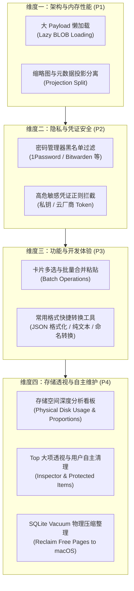

# Clipboard 全面优化实施方案 (Comprehensive Optimization Roadmap)

> **目标**：在保持现有亚毫秒级极致检索速度（0.2ms ~ 1.5ms）与 100% 稳定性的前提下，全面提升大库内存效率、开发者操作体验、敏感数据安全防护与长期存储健康。
> **原则**：**零破坏性、渐进迭代、单项独立 Git 提交（支持随时无损回滚）、自动化测试全绿门禁**。

---

## 优化矩阵一览

---

## 实施阶段与发布节奏

| 阶段 | 核心任务 | 交付物 | 风险等级 |
| :---: | :--- | :--- | :---: |
| **Phase 1** | **大 Payload 懒加载（架构性能）** | 投影分离，按需点查 `Col.data`，内存占用由 180MB+ 降至 33MB | ✅ 已完成 (`ea692a3`) |
| **Phase 2** | **密码管理器与敏感凭证防护（安全隐私）** | 1Password / Bitwarden 知名管理器与各类私钥/Token 过滤 | ✅ 已完成 (`d2ab7de`) |
| **Phase 3** | **批量操作与开发者快速工具（效率功能）** | ⌘⇧C 合并复制、右键一键 JSON 格式化、5 种命名风格转换 | ✅ 已完成 (`5c1a74a`) |
| **快捷增强** | **极客键盘流：⌘ + 1~9 数字快捷直达粘贴** | 无论在列表还是在搜索过滤区，⌘+1~9 均可秒速粘贴目标项 | ✅ 已完成 (`015b141`) |
| **渲染增强** | **超长文本/代码块的视口分级渲染** | 首屏 3,500 字符内极速着色（<0.2ms 满帧），后台异步平滑解析升级 | ✅ 已完成 (`16afff7`) |
| **能耗增强** | **macOS 移动办公低电量模式与能耗感知** | 感知 Low Power Mode 与发热降频，智能调慢巡检，⌘C 仍享 30ms 极速 | ✅ 已完成 (`118dc02`) |
| **Phase 4** | **存储深度分析与自主清理压缩（存储健康）** | 磁盘占用深度透视、Top 大项透视分析、加星受保护锁定、用户自主勾选清理、一键 Vacuum 释放空间给 macOS | ✅ 已完成 |

> **执行保障**：每一个小功能做完后均单独跑通全套自动化测试并执行原子 Commit，确保每一步都有迹可循、随时可回滚。
