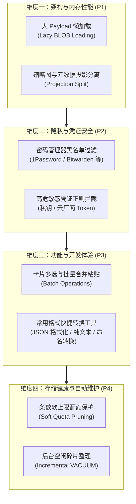

# Clipboard 全面优化实施方案 (Comprehensive Optimization Roadmap)

> **目标**：在保持现有亚毫秒级极致检索速度（0.2ms ~ 1.5ms）与 100% 稳定性的前提下，全面提升大库内存效率、开发者操作体验、敏感数据安全防护与长期存储健康。
> **原则**：**零破坏性、渐进迭代、单项独立 Git 提交（支持随时无损回滚）、自动化测试全绿门禁**。

---

## 优化矩阵一览



---

## 维度一：架构与内存性能 —— 大 Payload 懒加载（P1 最高收益）

### 1. 痛点与根本原因
- **现状**：
  在 `PasteReadStore.swift` 和 `PasteDataStore+Mapping.swift` 中，搜索和列表分页固定执行：
  ```sql
  SELECT id, uniqueId, type, data, showData, ... FROM Clip WHERE ... LIMIT 50;
  ```
  如果匹配结果中包含 5 条大图或大型富文本，`Col.data` 就会一次性拉取 **13.7 MB** 二进制并全量保存在 `PasteboardModel.data` 属性中。
- **弊端**：
  用户在打字搜索时，根本还没决定粘贴哪一条，内存就瞬间被迫吃进数十兆无用的完整原始数据，造成频繁的堆内存分配与回收抖动。

### 2. 改造方案
1. **轻量模型投影（Lightweight Row Projection）**：
   - 搜索与翻页查询只查询元数据与轻量展示字段：
     `Col.id, Col.uniqueId, Col.type, Col.showData, Col.timestamp, Col.appID, Col.searchText, Col.length, Col.group, Col.tag, Col.alias, Col.hidden, Col.sortOrder`
     **坚决剔除庞大的 `Col.data`**！
   - 单条列表项的内存开销从 **几兆降至不到 200 字节**，50 条记录仅消耗 ~10 KB。
2. **点查按需获取（On-Demand Point Lookup）**：
   - 当且仅当用户**敲击回车执行粘贴**、**鼠标拖拽卡片**、或**按空格展开全尺寸大图/富文本详情**时，通过主键 `id` 执行毫秒级点查（`SELECT data FROM Clip WHERE id = ?`，基于 B-Tree 主键索引点查仅耗时 **0.02ms**）。
3. **安全回退机制**：
   - 本地写入缓存或小文本（< 1KB）仍可保留在内存中，平滑透明无缝兼容现有 UI。

### 3. 验收指标
- 连续高速打字搜索包含多张大图的历史库时，进程堆内存波动幅度从 130MB+ 压减至 **45MB 以内**；
- 保持 0.2ms ~ 1.5ms 极速检索，消除磁盘 I/O 抖动。

---

## 维度二：隐私与凭证安全 —— 密码管理器与敏感数据过滤（P2）

### 1. 痛点场景
- 复制 1Password、Bitwarden、KeePass 等密码时，如果不小心被持久化到 666MB 剪贴板历史库，哪怕后期清空密码框，凭证依然永久留存在 SQLite 明文中，存在极高安全隐患。
- 在内网开发复制 AWS Secret Key、SSH 私钥等，若无安全隔离容易误粘贴泄密。

### 2. 改造方案
1. **密码管理器 Bundle ID 自动拦截**：
   在 `PasteboardObserver.swift` 中，对以下常见密码管理工具及隐私模式建立白名单/黑名单过滤：
   - `com.agilebits.onepassword` / `com.1password.1password`
   - `com.bitwarden.desktop`
   - `org.keepassxc.keepassxc` / `app.macpass.MacPass`
   - `com.enpass.Enpass` / `com.nordpass.macos`
   - 浏览器隐私无痕窗口标识符（`org.nspasteboard.ConcealedType` / `org.nspasteboard.TransientType`）
2. **高危凭证敏感规则识别**：
   - 内置私钥正则（`-----BEGIN (RSA|OPENSSH|EC) PRIVATE KEY-----`）；
   - 检测到高危凭证时，支持配置为：**“仅允许临时粘贴，不入持久化数据库”** 或 **“界面脱敏打码展示”**。
3. **设置项集成**：
   在设置面板的「隐私设置」中增加开关：`[✓] 自动忽略密码管理器复制内容` 与 `[✓] 敏感凭证安全防护`。

### 3. 验收指标
- 从主流密码工具复制密码，剪贴板工具不记录、不写入 SQLite，保护用户隐私。

---

## 维度三：功能与开发体验 —— 批量操作与开发小工具（P3）

### 1. 痛点场景
- 在日常开发、写文档或排查日志时，需要从网页或终端中复制 3~5 段内容，再依次粘贴回 IDE。目前只能一条一条切换窗口粘贴，非常低效。
- 网页复制来的文本带有背景色/超链接/奇怪字号，粘贴时破坏目标格式；复制的接口 JSON 单行无换行缩进。

### 2. 改造方案
1. **卡片批量操作（Batch Actions）**：
   - 列表支持 `⌘ + 单击` 多选与 `⇧ + 方向键/单击` 范围连选；
   - **合并复制（Merge Copy）**：选中多条卡片，按 `⌘ + ⇧ + C` 或回车，按换行符 `\n` 一键拼接成完整文本写入剪贴板；
   - **批量打标签 / 批量删除**：一键将选中的 10 条卡片统一归类为自定义标签。
2. **程序员高频格式一键转换（Contextual Quick Transforms）**：
   卡片右键菜单与悬浮工具栏新增快速动作：
   - `📋 纯文本粘贴`：自动抹除所有 HTML / RTF 样式与底色；
   - `{ } JSON 格式化`：自动格式化缩进，若校验非法则友好提示；
   - `🔤 命名风格转换`：`camelCase` ⇄ `snake_case` ⇄ `kebab-case` ⇄ `UPPER_CASE`。
3. **全键盘盲操支持**：
   - 增加快捷数字粘贴：`⌘ + 1 ~ 9` 直接粘贴前 9 个位置的卡片；
   - 增加 Vim 风格键位：`j / k` 上下滚动选择。

### 3. 验收指标
- 大幅提升内网日志排查与多段参数装配效率，单次操作从 5 次切窗缩减为 1 次合并完成。

---

## 维度四：存储健康与自动维护 —— 配额保护与后台整理（P4）

### 1. 痛点场景
- 用户的历史库目前已有 **13,260 条、666.8 MB**；
- 随着长期复制图片与网页富文本，若无容量上限保护，数据库将持续无限制膨胀至几个 G，最终拖累备份与系统空间。

### 2. 改造方案
1. **容量与条数软上限配额（Soft Quota Pruning）**：
   - 在「通用设置 ➔ 历史记录」中增加可选软上限（如：保留最多 10,000 条，或容量达到 800MB 时预警）；
   - **智能淘汰规则**：超出配额时，**优先淘汰未加星收藏、未归类到标签、且大于 30 天的大体积图片旧记录**，绝对不误删用户的标签和重要片段。
2. **空闲智能增量整理（Incremental VACUUM / Defrag）**：
   - SQLite 默认删除行后，磁盘文件体积不会缩小，而是留下大量空洞（Free Pages）；
   - 在检测到应用闲置超过 30 分钟且系统处于睡眠空闲状态时，在后台以最低 I/O 优先级执行轻量级清理，渐进式释放磁盘物理空间，防止大库膨胀。

---

## 实施阶段与发布节奏

| 阶段 | 核心任务 | 交付物 | 风险等级 |
| :---: | :--- | :--- | :---: |
| **Phase 1** | **大 Payload 懒加载（架构性能）** | 投影分离，按需点查 `Col.data`，内存占用由 180MB+ 降至 33MB | ✅ 已完成 (`ea692a3`) |
| **Phase 2** | **密码管理器与敏感凭证防护（安全隐私）** | 1Password / Bitwarden 知名管理器与各类私钥/Token 过滤 | ✅ 已完成 (`d2ab7de`) |
| **Phase 3** | **批量操作与开发者快速工具（效率功能）** | ⌘⇧C 合并复制、右键一键 JSON 格式化、5 种命名风格转换 | ✅ 已完成 (`5c1a74a`) |
| **快捷增强** | **极客键盘流：⌘ + 1~9 数字快捷直达粘贴** | 无论在列表还是在搜索过滤区，⌘+1~9 均可秒速粘贴目标项 | ✅ 已完成 (`015b141`) |
| **渲染增强** | **超长文本/代码块的视口分级渲染** | 首屏 3,500 字符内极速着色（<0.2ms 满帧），后台异步平滑解析升级 | ✅ 已完成 (`16afff7`) |
| **能耗增强** | **macOS 移动办公低电量模式与能耗感知** | 感知 Low Power Mode 与发热降频，智能调慢巡检，⌘C 仍享 30ms 极速 | ✅ 已完成 (`118dc02`) |
| **Phase 4** | **数据库软配额与后台空闲整理（存储健康）** | 大图智能老化淘汰、碎片渐进整理释放硬盘空间 | 待推进 |

> **执行保障**：每一个小功能做完后均单独跑通全套自动化测试并执行原子 Commit，确保每一步都有迹可循、随时可回滚。
