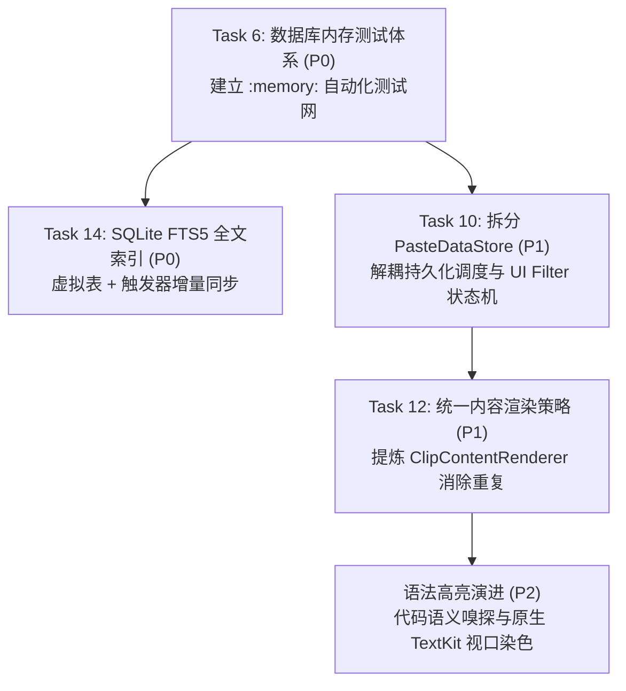

# Implementation Plan: 下一阶段深度治理与性能突破实施计划 (v9.9.2)

> **基线版本**：`v9.9.1`（已完成安全加固、协议抽象、VoiceOver 无障碍支持）  
> **设计原则**：严格遵循 `AGENTS.md` 规范（macOS 14.0+、Swift Concurrency、AppKit 优先、SnapKit 布局、无 force unwraps / `try!`、常规中文提交规范）。  
> **核心目标**：建立内存数据库单测防护网，引入 FTS5 毫秒级全文索引，解耦持久化与 UI 筛选状态机，统一卡片与悬浮行渲染器，预备代码语义与原生语法高亮演进。

---

## 一、阶段任务概览与依赖关系



---

## 二、详细任务拆解与实施方案

### Task 6: 数据库内存测试体系搭建 (P0 - 质量基线)

#### 1. 目标与价值
- 在无侵入的 `Tests/` 纯 SwiftPM 工程中引入 `SQLite.swift` 支持，建立纯内存（`Connection(.inMemory)`）测试环境。
- 脱离本地磁盘文件与用户物理数据，确保用例执行在 1 秒以内完成，为后续 Schema 迁移与 FTS5 变更提供坚实的安全防护网。

#### 2. 目标文件
- `Tests/Package.swift`
- `Tests/Sources/Tests/Database/MemoryDatabaseHelper.swift`（新建测试基类与内存 DB 辅助工具）
- `Tests/Sources/Tests/Database/SchemaMigrationTests.swift`（新建 Schema 与版本迁移断言）
- `Tests/Sources/Tests/Database/CRUDOperationTests.swift`（新建增删改查与约束断言）
- `Tests/Sources/Tests/Database/UndoRestoreTests.swift`（新建批量删除与快照原子恢复断言）

#### 3. 详细实施步骤
1. **更新测试包配置**：
   - 在 `Tests/Package.swift` 中引入 `SQLite.swift` 依赖（锁定与主工程相同的 `0.17.0`）。
2. **构建内存数据库上下文**：
   - 编写 `MemoryDatabaseHelper`，提供在内存中执行 `PasteSQLManager.createTable`、`SourceAppSQL.create`、`createIndexes` 的统一接口。
3. **编写覆盖用例**：
   - `SchemaMigrationTests`：验证字段默认值、`user_version` 读写、`uidx_unique_id` 唯一性约束。
   - `CRUDOperationTests`：验证文本/图片/富文本插入、自增主键与 `nextSortOrder` 连贯性、分组变更、隐藏状态切换、别名保存。
   - `UndoRestoreTests`：模拟批量删除生成 `ClipSnapshot`，验证事务内完整回滚恢复。

#### 4. 验收标准
- [ ] 运行 `swift run`（工作目录在 `Tests/`），内存数据库全套测试在 1.0 秒内秒级全绿通过。
- [ ] 主工程 `xcodebuild` 完全独立，不受任何配置污染。

#### 5. 预期 Commit
`test(db): 搭建基于 SQLite 内存数据库的自动化迁移与 CRUD 测试套件`

---

### Task 14: 引入 SQLite FTS5 全文搜索虚拟表 (P0 - 性能极致)

#### 1. 目标与价值
- 彻底解决关键词搜索时 `WHERE search_text LIKE '%token%'` 全表扫描造成的 CPU 占用与延迟瓶颈。
- 在 5 万 ~ 10 万条历史记录下，将搜索延迟从 >300ms 降至 <10ms，实现即输即显。

#### 2. 目标文件
- `Clipboard/Core/Data/PasteSQLManager+Migration.swift`
- `Clipboard/Core/Data/PasteSQLManager+Query.swift`
- `Clipboard/Core/Services/PasteFilterBuilder.swift`
- `Tests/Sources/Tests/Database/FTSTriggerTests.swift`（新建单测）

#### 3. 详细实施步骤
1. **数据库迁移版本升级至 `v2`**：
   - 在 `PasteSQLManager+Migration.swift` 中检测 `databaseUserVersion() < 2`。
   - 创建 FTS5 外部内容表 `clip_fts`（`content='Clip'`, `content_rowid='id'`, `tokenize='unicode61'`），避免重复存储文本正文。
   - 挂载 `clip_ai`（INSERT 后同步）、`clip_ad`（DELETE 后同步）、`clip_au`（UPDATE 后同步）三个 SQLite 触发器。
   - 执行初始索引填充：`INSERT INTO clip_fts(rowid, search_text, alias_search) SELECT id, search_text, alias_search FROM Clip;`。
   - 更新 `PRAGMA user_version = 2`。
2. **查询引擎升级**：
   - 在 `PasteFilterBuilder.swift` 中，将用户输入的词元转化为 FTS5 `MATCH` 语法（支持前缀匹配 `token*`）。
   - 在 `PasteSQLManager+Query.swift` 与 `PasteReadStore.swift` 中，当存在关键词时走 `clip_fts` 倒排检索，无关键词时走原有的 B-Tree 索引（`idx_hidden_ts` / `idx_group_ts`）。
3. **容灾降级机制**：
   - 若用户输入特殊标点导致 FTS5 语法解析异常（Syntax Error），无缝降级为原有 `LIKE` 扫描，杜绝查询抛错。
4. **单测验证**：
   - 编写 `FTSTriggerTests`，验证增删改查时触发器自动同步，断言 `MATCH` 准确命中。

#### 4. 验收标准
- [ ] 自动化测试验证：新增、修改别名、删除记录时，FTS5 索引自动同步，查询结果 100% 准确。
- [ ] 性能达标：万级数据下关键词检索响应时间 < 15ms。

#### 5. 预期 Commit
`perf(db): 接入 SQLite FTS5 全文检索虚拟表与触发器增量同步`

---

### Task 10: 拆分 `PasteDataStore` 数据存储与 UI 过滤状态机 (P1 - 架构解耦)

#### 1. 目标与价值
- 解除 `PasteDataStore` 的“上帝类”膨胀问题，将数据库持久化编排与 UI 瞬态筛选状态彻底隔离，建立清晰的单向数据流。

#### 2. 目标文件
- `Clipboard/Core/Data/PasteDataStore.swift`
- `Clipboard/Core/Models/ClipboardFilterState.swift`（新建 UI 筛选状态机）
- `Clipboard/Core/Data/ClipboardRepository.swift`（新建仓储持久化桥接器）

#### 3. 详细实施步骤
1. **提取 `ClipboardFilterState`**：
   - 将 `currentFilter`、`isInFilterMode`、`filteredCount`、当前选中的分组 Chip、日期区间、应用来源等 UI 筛选属性收拢至独立的 Observable 状态机。
   - 搜索词变动与筛选条件变更通过 Combine 响应式管道发布通知。
2. **纯化 `PasteDataStore`**：
   - 专注于向 UI 暴露 `dataList`、`totalCount`、`hasMoreData` 数据流。
   - 读操作通过 `PasteReadStore` 执行，写操作通过 `PasteSQLManager` + `mutationTail` 排队执行。
3. **消除冗余通知**：
   - 将散落在各处的 `NotificationCenter` 显式替换为 `Combine.Publisher` 订阅。

#### 4. 验收标准
- [ ] `PasteDataStore.swift` 瘦身至 250 行以内。
- [ ] UI 筛选状态变更具备单向数据流动性，无竞态条件。

#### 5. 预期 Commit
`refactor(store): 拆分持久化调度与 UI 筛选状态机`

---

### Task 12: 统一卡片与列表行内容渲染策略 (P1 - 重复消除)

#### 1. 目标与价值
- 消除 [CardContentView.swift](file:///Users/opm/Documents/data/code/clipboard/Clipboard/Features/Clip/Card/View/CardContentView.swift) 与 [FloatingCardRowView+Content.swift](file:///Users/opm/Documents/data/code/clipboard/Clipboard/Features/Clip/Floating/View/FloatingCardRowView+Content.swift) 之间 500+ 行重复的类型分发与视图装配逻辑。

#### 2. 目标文件
- `Clipboard/Features/Clip/Common/ClipContentRenderer.swift`（新建统一渲染中枢）
- `Clipboard/Features/Clip/Card/View/CardContentView.swift`
- `Clipboard/Features/Clip/Floating/View/FloatingCardRowView+Content.swift`

#### 3. 详细实施步骤
1. **抽象 `ClipContentRenderer` 策略协议**：
   - 定义富文本高亮、图片自适应排版、文件路径排版、URL Link 卡片、色彩预览块的通用生成协议。
2. **重构 Card 与 Floating 视图**：
   - 卡片网格（Card）与悬浮行（Floating）仅负责各自的布局容器尺寸，内部内容视图统一由 `ClipContentRenderer.render(...)` 驱动。
   - 统一深浅色外观变动的通知与重绘逻辑。

#### 4. 验收标准
- [ ] Card 视图与 Floating 视图内容展示严格一致。
- [ ] 消除重复渲染装配代码 400+ 行。

#### 5. 预期 Commit
`refactor(view): 抽取统一的剪贴板内容渲染器消除视图层重复`

---

### 演进专项：语法高亮与代码语义渐进支持 (P2 - 体验跃升)

#### 1. 目标与价值
- 解决纯代码在列表中全黑白、WebKit 预览内存消耗 50MB+ 的痛点。
- 将已暂存的嗅探器与原生 TextKit 视口染色深度结合。

#### 2. 核心实施路线
1. **恢复并集成代码语言嗅探器**：
   - 从 `stash@{0}` 中取出 `CodeLanguage.swift`、`CodeLanguageDetector.swift`、`CodeLanguageRules.swift`。
   - 在 `PasteboardModel` 中增加 `detectedLanguage: CodeLanguage?` 属性。
2. **基于 TextKit 原生视口染色**：
   - 废弃 `PreviewMarkdownView` 中的重型 `WKWebView`，使用纯原生 `NSTextStorage` + `NSLayoutManager.setTemporaryAttributes`。
   - 支持主流 12 种开发语言（Swift, Python, JS/TS, JSON, SQL, HTML/CSS, Go, Rust, C/C++, Shell, YAML, Markdown）的关键字、字符串、数字、注释高亮。
   - 原生支持 macOS 深色模式与动态高对比度颜色。

---

## 三、验收与发布里程碑（Roadmap）

```
阶段一：内存测试套件搭建 (Task 6)
  ↓ [swift run 秒级全绿]
阶段二：FTS5 全文索引迁移与触发器 (Task 14)
  ↓ [海量搜索延迟 <15ms]
阶段三：状态机拆分 (Task 10) & 渲染器统一 (Task 12)
  ↓ [消除重复代码 800+ 行]
阶段四：TextKit 原生语法高亮与体验打磨
  ↓
发布正式版本 v9.9.2
```

---

> 方案已完整记录并保存于 `tasks/refactor_v2_plan.md`。  
> 请您审阅，待您确认后我们将严格按计划展开实施！
